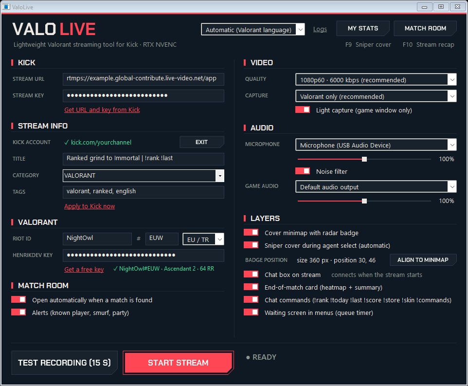
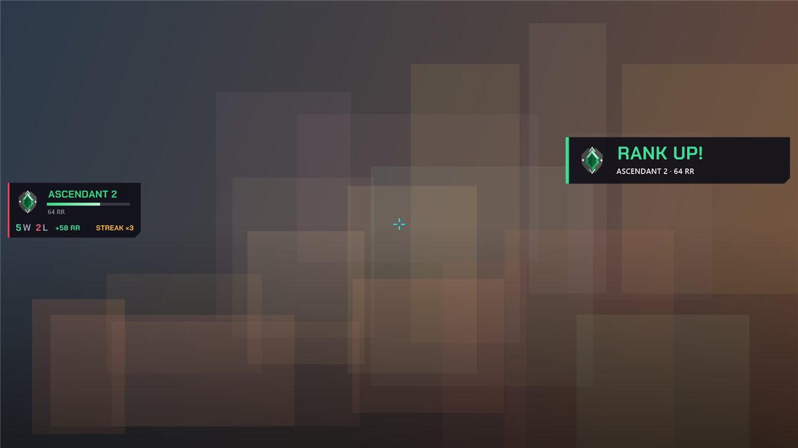
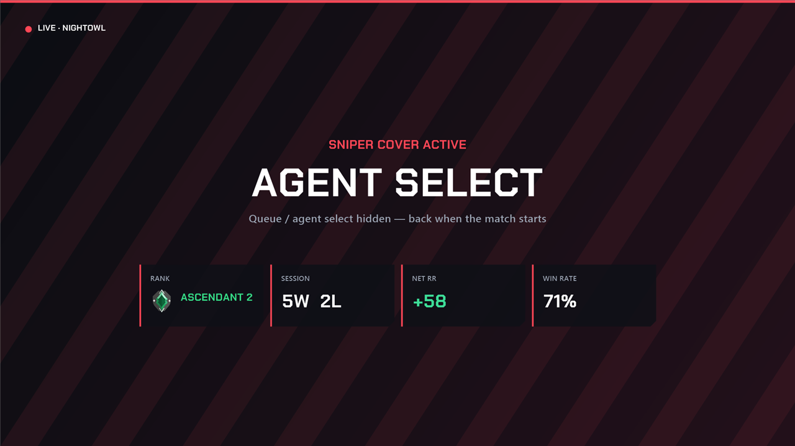
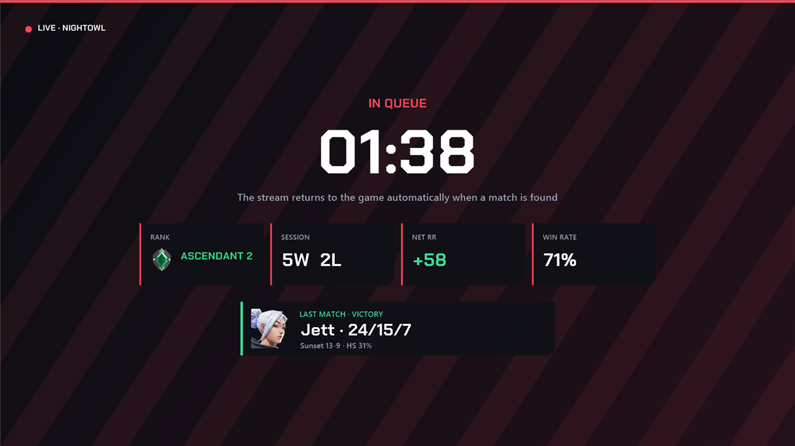
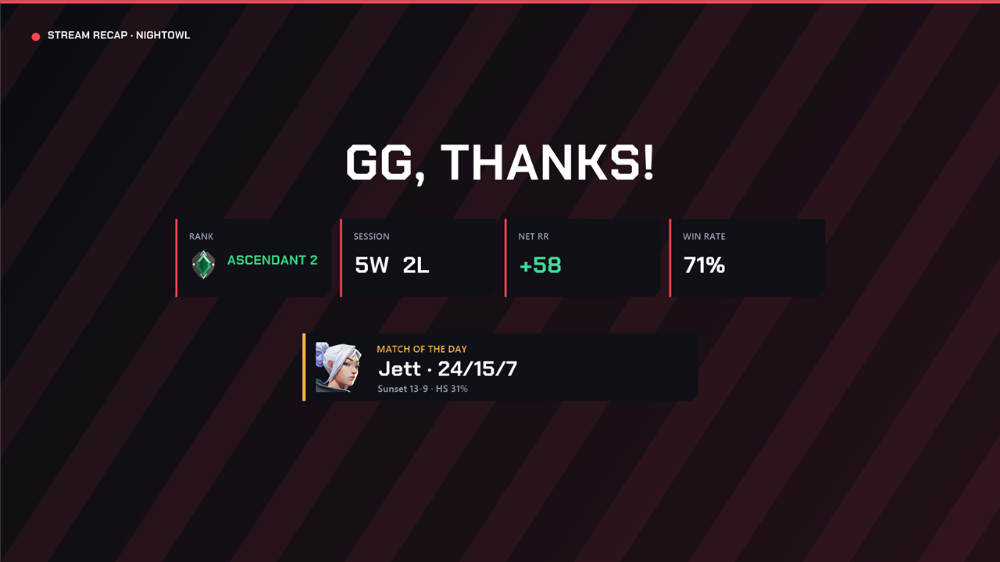
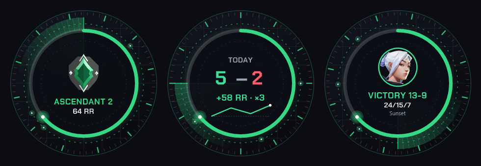
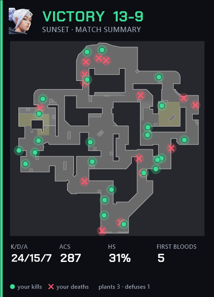
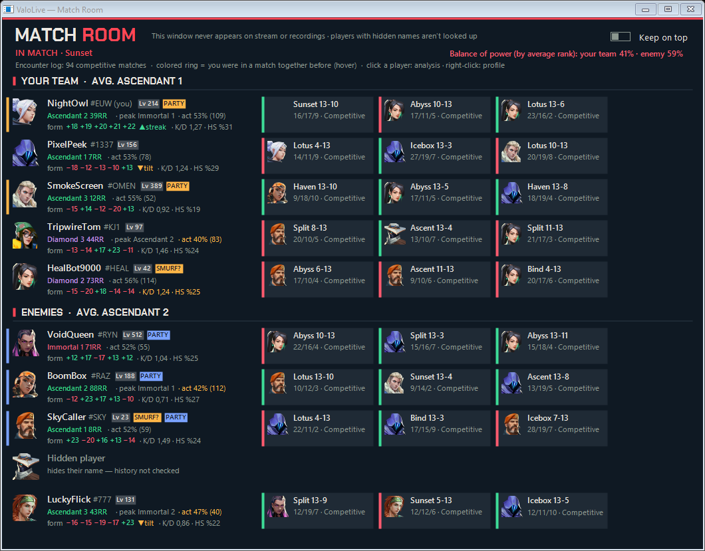
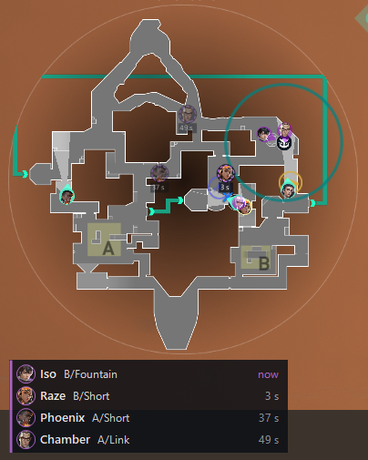

<div align="center">


# ValoLive

**A lightweight Valorant streaming companion for Kick: live overlays, a sniper cover, and a match room that scouts the lobby for you.**

[](https://github.com/bahattinkoc/ValoLive/releases/latest)


[English](#features) · [Türkçe](#türkçe)

</div>

---

Press **START STREAM** and you're streaming: ValoLive captures Valorant, encodes it on your RTX card and sends it to Kick. Your rank, session record and last match are drawn on top automatically. No OBS scenes, browser sources or plugins to set up.

<p align="center"></p>

## Features

### 🎥 One-click streaming to Kick
- Captures the game and encodes it with **NVENC**, so your CPU stays free for frames.
- **GPU engine** (on by default, toggle in the main window): capture, overlays and encoding all stay on the graphics card, the way OBS does it. It uses about 8× less CPU than the FFmpeg path, and ValoLive falls back to that path by itself if the engine can't start. Enemy memory and stream moments read the game frame from the engine too, instead of copying the screen.
- Sets your Kick **title and category** before you go live.
- Records your microphone along with the game audio.
- Optional **chat bot** that answers viewers from your account:

  | Command | Reply |
  |---|---|
  | `!rank` | Current rank and RR |
  | `!today` | Today's wins, losses and net RR |
  | `!last` | Your last match: agent, K/D/A, score |
  | `!score` | Live score of the current match |
  | `!store` / `!skin` | Today's store and the skin in your hands |
  | `!commands` | Lists all of the above |

### 📈 Overlays your chat will actually read
A compact rank card with session record, RR gain and win streak. When you rank up, a **RANK UP!** banner pops in on stream.

<p align="center"></p>

### 🛡️ Sniper cover (F9)
Agent select hides itself from the stream **automatically**, and the game comes back the moment the round starts. Press **F9** to cover the stream manually whenever you want.

<p align="center"></p>

### ⏱️ Queue screen and stream recap (F10)
While you're in queue, viewers see a timer, your session stats and your last match instead of the menu. Press **F10** at the end of the night for a **GG** recap card.

<p align="center">
  
  
</p>

### 📡 Radar badge
A small round widget in the corner of the stream. It cycles through your rank, today's record with an RR graph, and your last match.

<p align="center"></p>

### 🗺️ Post-match card
After every game, a card shows where you got your kills (●) and where you died (✕) on the minimap, plus K/D/A, ACS, HS% and first bloods.

<p align="center"></p>

### 🎬 Stream moments
ValoLive reads the scoreboard bar and calls out the big plays on stream as they happen: **first blood**, **clutch** attempts (1v2 … 1v5) with the result, **last enemy standing**, flawless rounds, round streaks, comebacks, match point and overtime. After the match, its best (and funniest) moments get a short banner: aces, 4Ks, ninja defuses, knife kills, fall deaths…

### 🎈 Chat fun: viewers play with your stream
Viewers type a command in Kick chat and it comes to life on screen. No channel points needed, just a cooldown per viewer (mods and you skip it).

| Command | What happens |
|---|---|
| `!balloon <msg>` / `!pop` | The message floats up on a balloon; `!pop` bursts it |
| `!plane <msg>` | A plane flies across towing the message as a banner |
| `!bottle <msg>` | A message in a bottle washes ashore |
| `!pigeon <msg>` | A pigeon delivers it (and leaves a little surprise) |
| `!paper <msg>` | A paper plane glides by |
| `!spray <msg>` | Graffiti on the wall for a minute |
| `!tomato` / `!egg` | Splat! |
| `!sticker <emoji>` | Slaps a sticker on the screen |
| `!firework` | Group goal: when enough viewers join, the fireworks show starts |
| `!race` | Duck race: everyone who joins gets a duck, the bot announces the winner |
| `!say <msg>` | A robot voice reads it out |
| `!flip` / `!zoom` | Flips the screen for 3 s / magnifies the crosshair for 6 s |

Plus **emoji rain** when chat spams the same emoji, and an **aquarium** where everyone who chats swims as a fish. Links are stripped and a banned-words list is applied. Every effect can be switched off one by one, and **PREVIEW** lets you try them all without going live.

### 🎛️ Stream panel
All on-stream settings (overlays, radar badge, sniper cover, chat fun) live in their own **Stream Panel** window. Open it from the main window or the tray icon.

### 🔍 Match Room: know who you're up against
Open it during agent select or in game, and every player in the lobby is scouted for you:
- **Rank, peak rank, level, act win rate**, K/D and HS% for every player.
- **Recent form** in RR (`▲streak` or `▼tilt`) plus their last three matches with agents and scores.
- **Party detection**: duos and stacks are color-tagged on both teams.
- **Smurf warnings** for low-level accounts with suspiciously good stats.
- **Encounter log**: a colored ring shows players you've met before, and whether they were teammates or enemies.
- **Balance of power**: your team's average rank against theirs.
- **Briefing**: the most useful findings grouped as Danger, Chance, Position, Your team and Familiar faces: one-trick and first-time agents, Operator players, clutch and tilt patterns, duos, long sessions.
- **Map tab**: where the enemies usually fight on this map on defense and attack, and where their team plants the spike.
- **Agent select view**: your team's agent pools and who has locked in, before the enemies are known.
- Players with hidden names stay hidden. ValoLive doesn't look them up.

<p align="center"></p>

Everything fits in a compact tabbed window (Briefing, Map, Enemies, Team) with all ten agents in a strip at the bottom. Click a player to open their own tab with every detail, or right-click to open their profile. **MY STATS** runs the same breakdown on your own account: your best maps, agents and recent form.

### 🧠 Enemy memory (experimental)
Clutching 1v2 and can't remember where you last saw their Jett? ValoLive watches your minimap and remembers it for you.
- Every enemy you or your team spots is remembered with the **callout** where they were last seen and **how long ago**.
- Show it as a small list under the minimap, as **icons on the minimap itself**, or both.
- **Dead enemies are dropped** as soon as they leave the scoreboard bar (Sage revives are picked up too), and the memory resets every round.
- Works on every current map and reads only what's already on your screen: about 12 ms of work, 10 times a second.

<p align="center"></p>

> Off by default; turn it on under **MATCH ROOM**. It needs the enemy highlight color set to **purple** and a minimap that isn't centered on you. This feature gives you information during a match. Third-party tools like that may conflict with Riot's terms, so use it at your own risk.

### 🌍 16 languages
English, Türkçe, Deutsch, Español, Français, Italiano, Polski, Português, Русский, العربية, 日本語, 한국어, 中文, ไทย, Tiếng Việt, Bahasa Indonesia. These are the languages spoken across Valorant's servers. Pick one in settings and the whole app, the overlays and the chat bot switch with it.

### 🔒 Privacy first
- ValoLive's own windows **never show up on stream or in recordings**, so the Match Room is for your eyes only.
- Your Kick stream key and API keys are **encrypted on your PC** (Windows DPAPI) and are never sent anywhere else.
- ValoLive only reads the local Valorant client API and, for enemy memory, the pixels already on your screen. It doesn't inject anything into the game or touch its memory.

## Requirements

- Windows 10 or 11 (64-bit)
- An NVIDIA GPU with NVENC (RTX recommended)
- [.NET Framework 4.8](https://dotnet.microsoft.com/download/dotnet-framework/net48) (already included in up-to-date Windows 10/11)
- **FFmpeg**: install it with one command:
  ```
  winget install Gyan.FFmpeg
  ```
  Or put `ffmpeg.exe` next to `ValoLive.exe`.
- A Kick account and its stream key

## Getting started

1. Download the latest `ValoLive-vX.Y.Z.zip` from **[Releases](https://github.com/bahattinkoc/ValoLive/releases/latest)** and extract it anywhere.
2. Run `ValoLive.exe`. If Windows SmartScreen warns you, click **More info → Run anyway** (the app isn't code-signed).
3. Paste your Kick **stream URL and key** (Kick → Creator Dashboard → Settings). Optionally press **Connect** to link your Kick account for title, category and the chat bot.
4. Launch Valorant, pick your microphone and press **START STREAM**. GL HF! 🎯

> Press **TEST RECORDING (15 s)** first to check the picture and sound without going live.

## Building from source

You need the Visual Studio 2022 Build Tools (they include the C# compiler).

```powershell
git clone https://github.com/bahattinkoc/ValoLive.git
cd ValoLive
.\build.ps1
```

This produces `ValoLive.exe` in the repo folder. The GPU engine (`valocap.exe`, C++) needs the **Desktop development with C++** workload (MSVC and the Windows SDK):

```powershell
.\native\build.ps1
```

It writes `valocap.exe` next to `ValoLive.exe`. Without it the GPU engine toggle is hidden and ValoLive streams through FFmpeg.

`.\release.ps1 -Notes notes.md` builds both, packs the zip and publishes the GitHub release for the version in `src\AssemblyInfo.cs` (add `-DryRun` to only build and pack). Translations are in `lang/`. Run `lang-sync.ps1` to check them for missing keys.

## Disclaimer

ValoLive isn't endorsed by Riot Games and doesn't reflect the views or opinions of Riot Games or anyone officially involved in producing or managing Riot Games properties. Riot Games and all associated properties are trademarks or registered trademarks of Riot Games, Inc.

---

## Türkçe

**ValoLive**, Kick için hafif bir Valorant yayın aracıdır. **Yayını başlat**'a basarsın: oyun ekran kartında (NVENC) kodlanıp Kick'e gider. Rankın, günlük skorun ve son maçın yayına otomatik olarak işlenir. OBS sahnesi ya da eklenti kurman gerekmez.

- **Tek tıkla Kick yayını**: Başlığı ve kategoriyi ayarlar, mikrofonunu oyun sesiyle birlikte alır, istersen sohbet botunu da çalıştırır (`!rank`, `!bugün`, `!son`, `!skor`, `!mağaza`, `!skin`, `!komutlar`).
- **Overlay'ler**: Rank kartı, günlük G/M, RR kazancı ve seri gösterilir. Rank atlayınca yayında **RANK ATLADIN!** bandı çıkar.
- **Sniper koruması (F9)**: Ajan seçimi yayından otomatik gizlenir, maç başlayınca görüntü geri gelir.
- **Sıra ekranı ve yayın özeti (F10)**: Sırada beklerken izleyici menü yerine sayaç ve istatistik görür. Gece sonunda **GG** kartı gösterilir.
- **Radar rozeti**: Köşede dönen küçük bir widget. Sırayla rankını, günün skorunu ve son maçını gösterir.
- **Maç sonu kartı**: Haritada nerede adam vurduğunu ve nerede öldüğünü gösterir; yanında K/D/A, ACS, HS% ve ilk kanlar yer alır.
- **Yayın anları**: İlk kan, clutch denemeleri ve sonucu, son rakip, kusursuz raundlar, raund serileri, geri dönüşler, maç sayısı ve uzatma yayında anında duyurulur. Maç bitince en iyi (ve en komik) anlar kısa bir bantla gösterilir: ace, 4K, ninja defuse, bıçak kill, düşerek ölme…
- **Chat eğlencesi**: İzleyiciler chat'e komut yazar, ekranda canlanır: `!balloon`, `!plane`, `!bottle`, `!pigeon`, `!paper`, `!spray`, `!tomato`, `!egg`, `!sticker`, `!firework`, `!race`, `!say`, `!flip`, `!zoom`. Ayrıca emoji yağmuru ve chat'e yazanların balık olduğu bir akvaryum var. Kanal puanı gerekmez, her izleyicinin bekleme süresi vardır. **ÖNİZLEME** ile yayın açmadan denenebilir.
- **Yayın Paneli**: Yayın üstü bütün ayarlar ayrı bir pencerede; ana pencereden ya da tepsi simgesinden açılır.
- **Maç Odası**: Lobideki herkesin rankı, en yüksek rankı, formu (▲seri / ▼tilt), son maçları, **parti tespiti**, **smurf uyarısı**, daha önce karşılaştığın oyuncular ve takımların güç dengesi. Sekmeli küçük pencerede gruplu **brifing** (tehlike, fırsat, konum), rakiplerin haritada nerede oynadığını gösteren **Harita** sekmesi ve ajan seçiminde takımının ajan havuzu.
- **Rakip hafızası (deneysel)**: Minimap'te senin ya da takımının gördüğü her rakibin son görüldüğü yeri ve ne kadar önce görüldüğünü hatırlar. Minimap'in altında liste olarak, haritanın üstünde ikon olarak ya da ikisi birden gösterilir. Ölen rakipler skor çubuğundan anlaşılıp listeden düşer, her raund sıfırlanır. Varsayılan olarak kapalıdır, **MAÇ ODASI** altından açılır. Rakip vurgu rengi **mor** olmalıdır. Maç sırasında bilgi veren üçüncü taraf araçlar Riot kurallarıyla çelişebilir; kullanım sorumluluğu sana aittir.
- **16 dil**: Valorant sunucularında konuşulan diller.
- **Gizlilik**: ValoLive pencereleri yayına ve kayda girmez. Yayın anahtarın bilgisayarında şifreli (DPAPI) saklanır. Oyuna hiçbir şey enjekte edilmez; rakip hafızası yalnızca ekranda zaten görünen görüntüyü okur.

**Kurulum:** [Releases](https://github.com/bahattinkoc/ValoLive/releases/latest) sayfasından zip'i indirip açın, `winget install Gyan.FFmpeg` ile FFmpeg'i kurun ve `ValoLive.exe`'yi çalıştırın. SmartScreen uyarı verirse **Ek bilgi → Yine de çalıştır** deyin.

<div align="center"><sub>Made with ❤️ for the Valorant streaming community · GPL-3.0</sub></div>
